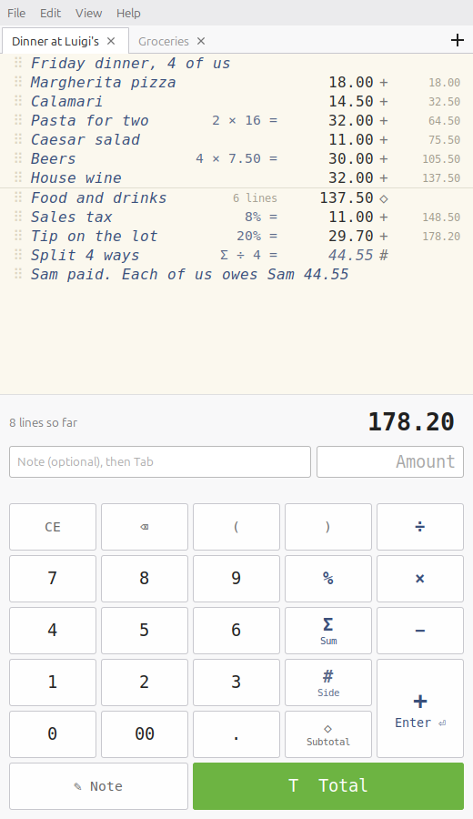

# TallyForth

A desktop adding-machine calculator for Linux, with a paper tape that keeps a
running tally and lets you write notes next to the numbers.



Type `Potato salad $55` and press Enter: the note and the amount go on the tape
together, and the total updates. It's built for everyday business math, such as
budgets, quotes, receipts and reconciling a statement, so it has percentages but
no scientific functions.

## Features

- **Notes next to numbers.** Every line can carry a note, and lines can be just notes.
- **Working shown on the line.** `2 × 55` stays on the tape as `2 × 55 = 110.00`.
- **Side calculations.** Press `#`, the adding machine's non-add key, to work something out without adding it to the tally (`=` works too).
- **Business percentages.** `200 + 8%` is 216, and `Σ` stands for the running total.
- **Subtotals and totals.** `◇` shows a subtotal, and `T` totals and starts a fresh tally.
- **Cents that add up.** Each line is rounded half-up, so printed lines always match the total.
- **Edit the tape.** Select, delete, edit, add notes above, or drag lines to reorder them; everything recalculates.
- **Paste a list.** Paste a column from a spreadsheet or bank statement and each line becomes a tape line.
- **Tabs.** Keep several tapes open; they're saved automatically and come back next time.
- **Export** as text or CSV, and zoom the tape text.
- **Full undo and redo.**

## Install

### As a Flatpak (any distro)

Works on Fedora, Debian, Ubuntu, Mint and anything else with Flatpak. You need
the Flathub remote and Flatpak Builder:

```bash
flatpak remote-add --user --if-not-exists flathub https://dl.flathub.org/repo/flathub.flatpakrepo
flatpak install --user flathub org.flatpak.Builder org.gnome.Sdk//50
git clone https://github.com/ryanghowell/TallyForth.git
cd TallyForth
flatpak run org.flatpak.Builder --user --install --force-clean build-dir io.github.ryanghowell.TallyForth.yml
```

Then start it from your applications menu, or with
`flatpak run io.github.ryanghowell.TallyForth`. The Flatpak keeps its tapes in
`~/.var/app/io.github.ryanghowell.TallyForth/`. The first time it runs, it
copies in any tapes from a non-Flatpak install.

### Directly from source

You need Python 3 with GTK 3 bindings (PyGObject), which come with most
desktops. If they're missing:

```bash
sudo apt install python3-gi gir1.2-gtk-3.0     # Debian, Ubuntu, Mint
sudo dnf install python3-gobject gtk3          # Fedora
```

Then:

```bash
git clone https://github.com/ryanghowell/TallyForth.git
cd TallyForth
./install.sh
```

This installs for your user only (no sudo) and adds TallyForth to your
applications menu. To try it without installing, run `python3 tallyforth.py`.
Tapes are saved automatically in `~/.local/share/tallyforth/`.

**File → Save** writes a `.tally` file wherever you choose.

## Keyboard

| Key | Does |
| --- | --- |
| Enter or `+` | Add the line |
| `-` | Subtract the line |
| `#` (or `=`) | Side calculation (not added) |
| `t` / `s` then Enter | Total / subtotal |
| Tab | Move from the note to the amount |
| ↑ | Move into the tape to select lines |
| Delete | Delete the selected lines |
| Ctrl+T / Ctrl+W | New tape / close tape |
| Ctrl+Z / Ctrl+Shift+Z | Undo / redo |
| Ctrl+ + / Ctrl+ − / Ctrl+0 | Zoom |
| F1 | All shortcuts |

## Development

The arithmetic and tape model are in `tapecore.py`, which doesn't use GTK. The
window is `tallyforth.py`. Run the tests with:

```bash
python3 -m unittest -v
```

Bug reports and pull requests are welcome.

## License

TallyForth is free software, released under the
[GNU General Public License v3.0 or later](LICENSE).
